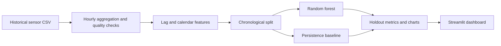
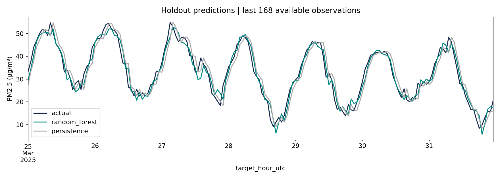
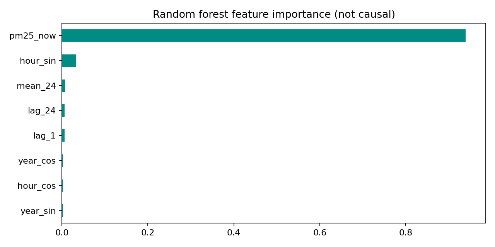

# Almaty Air Quality Forecasting

**One-hour-ahead PM2.5 prediction | Python · scikit-learn · Streamlit**

A portfolio reconstruction of a July 2026 WGU Advanced AI/ML capstone by Arailym Amir, developed with AI assistance. The original capstone investigated particulate pollution in Almaty, Kazakhstan. This version focuses on a reproducible forecasting experiment: can a random forest outperform simply assuming that next hour's pollution equals the latest reading?

> **Status:** The original notebook and dataset have not been recovered. This repository contains newly reconstructed code, tested on synthetic data. Real Almaty performance is not yet established. The original resume documented 530,000+ observations; that count is not a result of this version.

## Problem and approach

Air quality monitoring describes what is happening now. Forecasting could support earlier planning, but only if the model is evaluated on genuinely unseen future observations. This prototype predicts PM2.5 concentration in µg/m³ one hour ahead using historical readings and calendar features. It is not a deployed warning system or a medical advisory.



## Reproduce the demo

Python 3.11 recommended. From the repository directory:

```bash
python3 -m venv .venv
source .venv/bin/activate
pip install -r requirements.txt
python demo.py
python forecast.py data/synthetic.csv --out reports/synthetic_demo
python -m pytest -q
streamlit run app.py
```

On Windows activate with `.venv\Scripts\activate`. Upload `data/synthetic.csv` in the app to explore the workflow. For notebook exploration, run `jupyter notebook` and open `notebooks/forecast_walkthrough.ipynb`.

## Data: run with real observations

Candidate replacement source: [Almaty Air Initiative open air quality data](https://github.com/Almaty-Air-Initiative/kz-open-air-quality-data), which lists historical CSVs from local sensor networks. The original approval document also listed [OpenAQ](https://openaq.org/). Exact original dataset identity is unverified. Check source permissions and attribution before redistributing data; raw observations are not included here.

1. Download an appropriate historical CSV from the source. Select a single station in Almaty with sufficient hourly coverage (preferably at least one year).
2. Inspect the source's units and timestamp timezone. Convert timestamps to timezone-aware UTC (do not assume a fixed local offset for historical dates). Convert PM2.5 to µg/m³ if necessary. Do not use AQI values in place of concentration.
3. Save two columns, `timestamp` and `pm25`, in `data/almaty.csv`, or provide source column names explicitly. Multiple stations must not be mixed inadvertently.
4. Run `python forecast.py data/almaty.csv --out reports/run`. Optional arguments: `--time timestamp --target pm25 --station station_id=123` (replace with actual values). The CLI expects UTC timestamps, including explicit offsets if not already UTC.

## Methodology

- Negative or invalid concentrations and invalid timestamps are removed; duplicate/sub-hourly readings are reduced to hourly medians. Missing hours remain missing rather than being interpolated using future values.
- Features available at issue time: latest completed hourly median, 1-hour and 24-hour lags, trailing 24-hour average (minimum 18 valid hours), cyclical local hour and day-of-year.
- Target: next hourly median. The timestamp represents an hourly bin; issue time is understood as the end of that bin, after its observations are available.
- Complete windows only; this may bias coverage toward well-functioning sensors.
- Final 20% of complete windows held out in chronological order; one row purged at the boundary. Five expanding-window validation folds with a one-row gap on training data. No random shuffle or future pollution predictors.
- Compare a fixed random forest to persistence (latest measurement). Report MAE, RMSE, R² and fold-level results. No hyperparameter selection on the holdout.

## Demonstration results — synthetic data only

The charts below verify that the software runs; they do not measure actual air quality or establish effectiveness in Almaty.





See [demo metrics](reports/synthetic_demo/metrics.json) and [holdout predictions](reports/synthetic_demo/predictions.csv). A model that fails to beat persistence on real data should not be promoted as an improvement.

## Limitations and next steps

The model is retrospective and assumes the latest completed hourly observation is available without delay. Real sensors may report late or have calibration differences. No meteorological forecasts, spatial validation, prediction intervals or operational alert thresholds are included. Real-data evaluation, seasonal error analysis, station-specific validation and a weather-enhanced comparison are needed before any deployment. Feature importance is descriptive, not causal.

## Repository layout

- `forecast.py` — preprocessing, feature engineering, validation, training and reporting
- `demo.py` — deterministic synthetic test data generator
- `app.py` — interactive CSV-based evaluation dashboard
- `notebooks/` — guided reproducibility walkthrough
- `tests/` — leakage and end-to-end checks
- `reports/synthetic_demo/` — generated demonstration outputs
- `.github/workflows/` — automated test workflow

Original academic work: July 2026. Portfolio reconstruction: November 2026. No institutional endorsement or real-world deployment is claimed.
